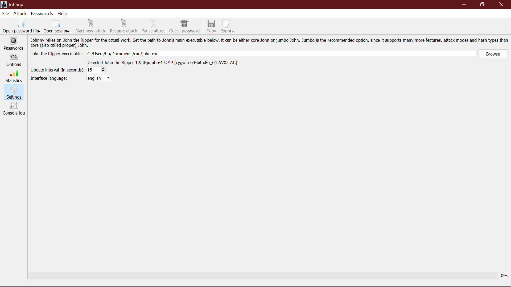
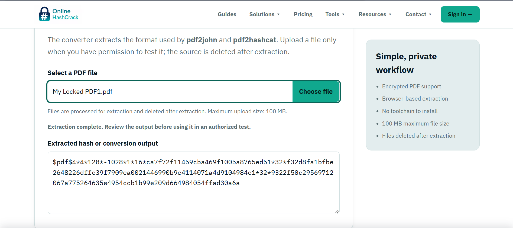
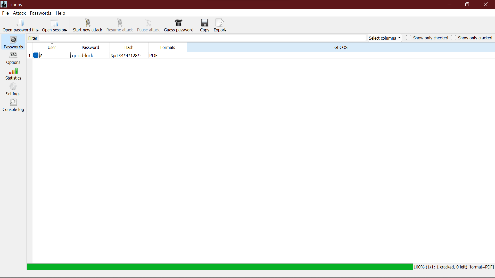
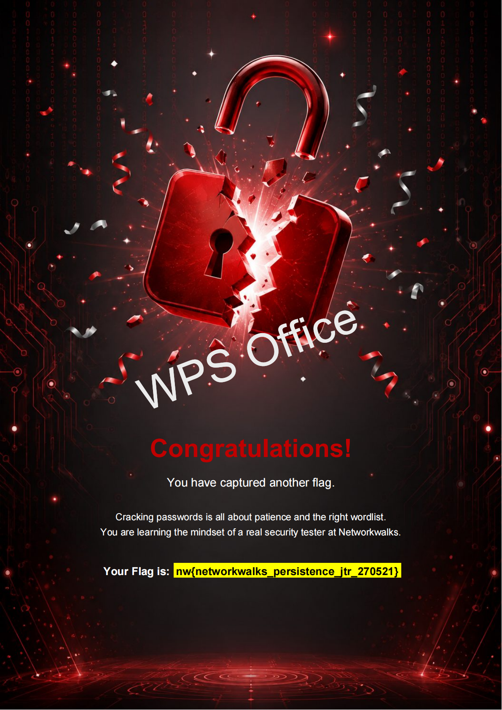
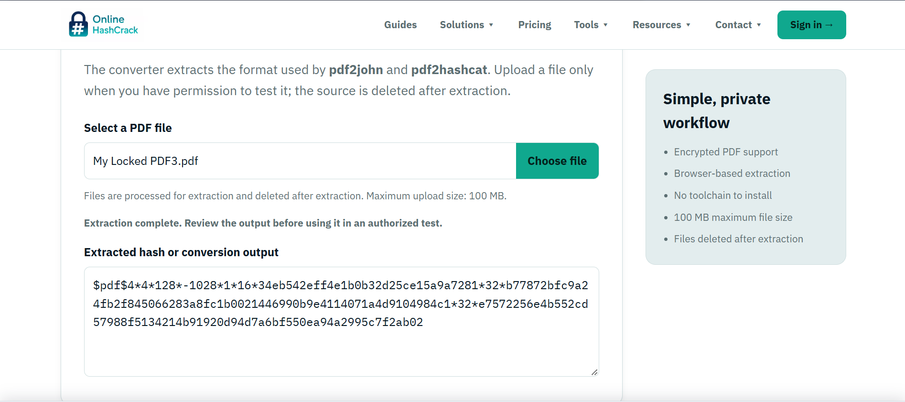
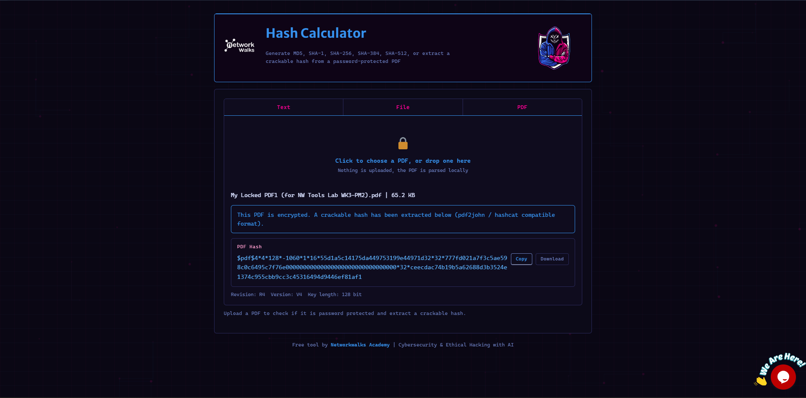
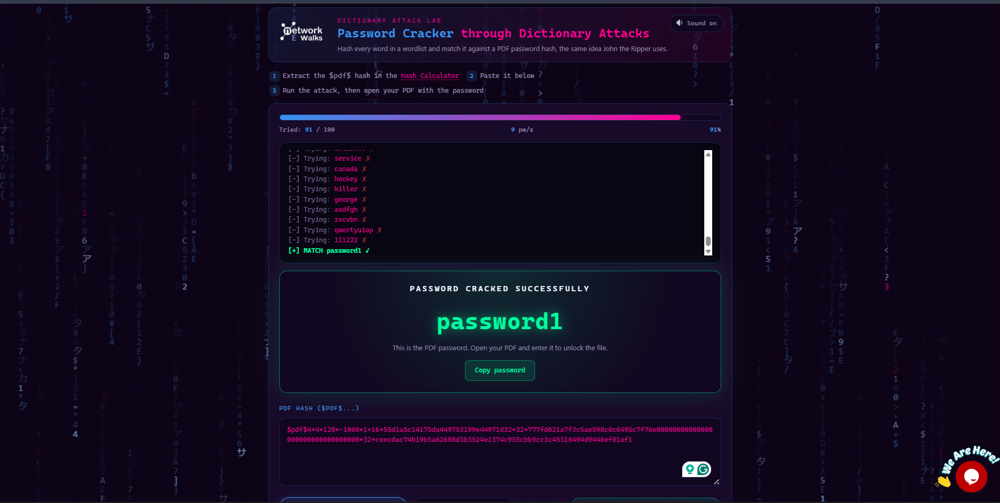

# NETWORKWALKS-B084-WEEK3-PASSWORD-CRACKING-USING-JTR
*Password Cracking with John the Ripper and Networkwalks Tools.*

## 📌 Project Overview

This practical focused on recovering passwords from three protected PDF files using John the Ripper (JTR), Johnny, and Networkwalks password-cracking tools. The exercise involved extracting password hashes, testing different wordlists, and performing dictionary attacks. After overcoming initial challenges with wordlist selection, all three files were successfully unlocked, providing hands-on experience in password cracking, hash extraction, and cybersecurity troubleshooting.

## 🎯 Project Objectives

- Understand the fundamentals of password cracking and hash extraction.
- Learn how to use John the Ripper and Networkwalks password-cracking tools.
- Explore how dictionaries and wordlists are used in password recovery.
- Perform dictionary attacks on password-protected PDF files.
- Develop troubleshooting skills when working with password-cracking tools.
- Successfully recover the passwords and unlock all three provided PDF files.

## 🛠️ Tools and Technologies Used

| Tool | Purpose |
|---|---|
| John the Ripper (JTR) | Cracks passwords by testing candidate passwords against extracted hashes. |
| Johnny | Provides a graphical interface for managing John the Ripper attacks. |
| Networkwalks Hash Calculator | Extracts password hashes from protected PDF files. |
| Networkwalks Password Cracker | Tests password candidates against extracted hashes. |
| Wordlists | Provide password candidates for dictionary attacks. |
| Windows 11 | Operating system used for the practical. |

## 🔍 Part 1 – Password Cracking with John the Ripper (JTR)

### 1. Installation and Configuration

- Downloaded John the Ripper (JTR) Windows binaries from its official website.
- Downloaded the Johnny graphical interface from its official website.
- Ran the Johnny setup file and completed the installation.
- Opened Johnny and navigated to **Settings** to configure the John the Ripper executable.
- Located `john.exe` inside the `run` folder of the extracted John the Ripper directory.
- Selected the executable to connect Johnny with the John the Ripper engine.
- Confirmed that Johnny was properly configured and ready for use.

**Evidence:**

### 2. Hash Extraction

- Downloaded the password-protected file named `My Locked PDF1.pdf` from the Networkwalks internship lab.
- Opened the Online Hash Crack PDF Hash Extractor website.
- Uploaded the protected PDF file to extract its password hash.
- Copied the generated hash, which was presented in the `$pdf$...` format.
- Checked the extracted hash to ensure it was complete and did not contain unwanted characters.
- Opened Notepad, pasted the hash and saved it as `hash1.txt` for use with John the Ripper.

**Evidence:**

### 3. Password Cracking Process

- Launched the Johnny application after completing its configuration.
- Clicked on **Open Password File** and selected the previously created `hash1.txt` file.
- Confirmed that the extracted hash was successfully loaded into Johnny.
- Selected **Start New Attack** to begin the password-cracking process.
- Allowed John the Ripper to test password candidates using its default wordlist attack mode.
- Waited for the process to complete, after which the password was successfully recovered.

**Evidence:**

### 4. Password Verification

- Opened the original `My Locked PDF1.pdf` file.
- Entered the password recovered through Johnny.
- Confirmed that the password was correct and the protected PDF opened successfully.

**Evidence:**

### 5. Password Cracking for PDF 2

- Loaded the extracted hash of the second protected PDF into John the Ripper.
- Started a dictionary-based password attack using the available wordlist.
- Allowed the tool to test password candidates until the password was recovered.
- Opened the second PDF and entered the recovered password.
- Confirmed that the document was successfully unlocked.

**Evidence:**

### 6. Password Cracking for PDF 3

- Loaded the extracted hash of the third protected PDF into John the Ripper.
- Started the password-cracking process using the available wordlist.
- Waited for John the Ripper to identify the correct password.
- Opened the third PDF and entered the recovered password.
- Confirmed that the document was successfully unlocked.

**Evidence:**

### 7. Observation

John the Ripper successfully recovered the password for the first protected PDF using its default wordlist attack mode. The exercise demonstrated how dictionary attacks can identify weak passwords by testing password candidates against extracted hashes.

The practical also provided experience in configuring password-cracking tools, handling extracted hashes and verifying recovered passwords. It highlighted the importance of using strong and unpredictable passwords to protect sensitive documents.

## 🔍 Part 2 – Password Cracking with Networkwalks Tools

### 1. Hash Extraction

- Opened the Networkwalks Hash Calculator in a web browser.
- Uploaded the protected PDF file downloaded from the internship lab.
- Allowed the tool to extract the password hash from the document.
- Copied the generated hash, ensuring the complete value was captured in the `$pdf$...` format.

**Evidence:**

### 2. Password Cracking Process

- Opened the Networkwalks Password Cracker.
- Pasted the extracted PDF hash into the provided input field.
- Started the cracking process using the built-in dictionary of approximately 100 common passwords.
- Observed that the initial attempt did not recover the password.
- Obtained a larger wordlist from the internship resources.
- Uploaded the larger wordlist and restarted the cracking process.
- Successfully recovered the PDF password.

**Evidence:**

### 3. Password Verification

- Copied the recovered password from the Networkwalks Password Cracker.
- Opened the original protected PDF file.
- Entered the recovered password to unlock the document.
- Confirmed that the PDF opened successfully.

**Evidence:**

### 4. Observation

The Networkwalks tools successfully recovered the password after the initial attempt with the smaller dictionary proved unsuccessful. Using a larger wordlist improved the chances of finding the correct password. This practical demonstrated the importance of wordlist selection in dictionary attacks and provided additional experience in hash extraction and password recovery.
